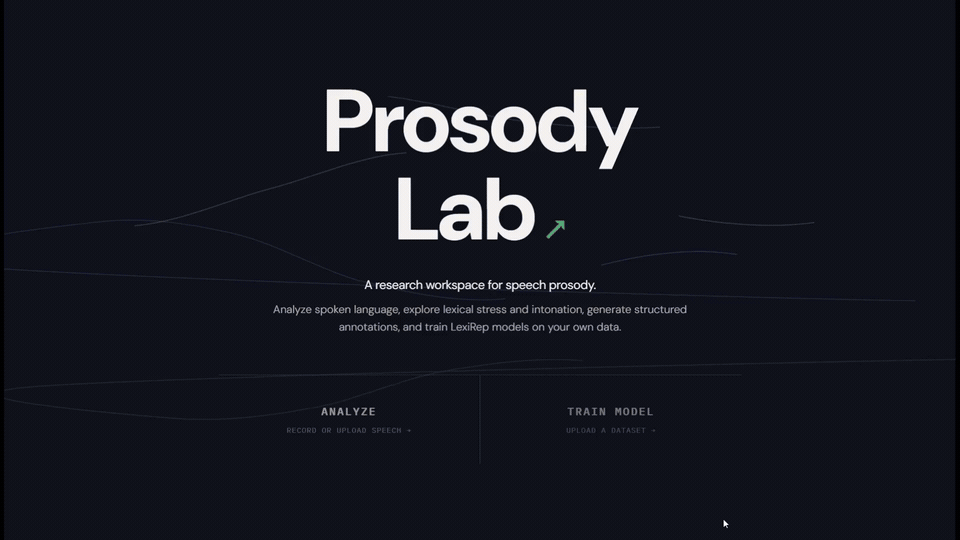
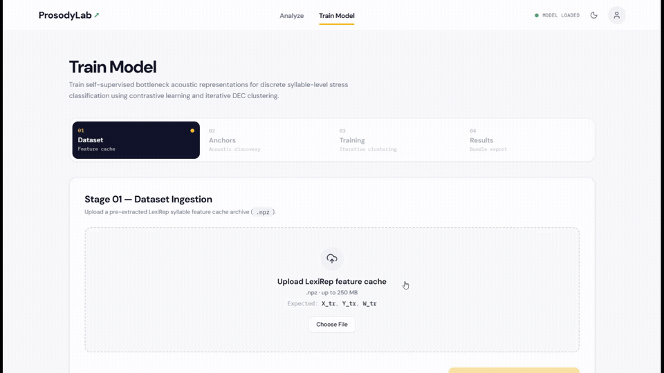
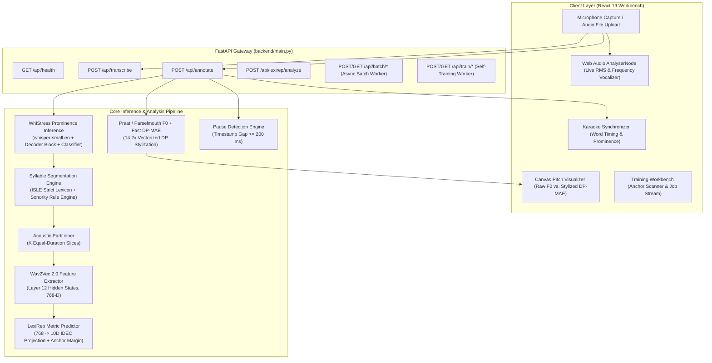

# ProsodyLab: End-to-End Speech Prosody Analysis & Acoustic Metric Learning

[](https://www.python.org/)
[](https://pytorch.org/)
[](https://fastapi.tiangolo.com/)
[](https://react.dev/)
[](https://vitejs.dev/)
[](LICENSE)

> **A Research-Grade Phonetics Workbench & Deep Representation Learning System**  
> *Integrates acoustic foundation models (Whisper, Wav2Vec 2.0) with classical acoustic phonetics to detect sentence prominence, classify syllable-level lexical stress via metric learning, stylize pitch contours via fast dynamic programming, and evaluate non-native English prosody.*

🌐 **Live Research Demonstration:** [https://aerospace-theology-refining.ngrok-free.dev/](https://aerospace-theology-refining.ngrok-free.dev/)  
📁 **GitHub Repository:** [https://github.com/Sreelm10sj/ProsodyLab](https://github.com/Sreelm10sj/ProsodyLab)

---

## 1. Project Overview

Automatic Speech Recognition (ASR) systems have attained remarkable word error rates, but standard architectures routinely **discard acoustic prosody**—the rhythm, syllable stress patterns, pause intervals, and melodic intonation of human speech.

In natural spoken communication, prosodic cues convey essential linguistic and pedagogical information:
- **Lexical contrast & category:** Distinguishing noun/verb pairs (e.g., *'OB-ject* vs. *ob-'JECT*).
- **Information structure & sentence focus:** Identifying emphasized, prominent words in running discourse.
- **Syntactic & phrase structure:** Marking clause boundaries via silent pause intervals and pitch resets.
- **Second-Language (L2) Assessment:** Detecting non-native lexical stress placement and rhythm transfer that directly affect intelligibility.

Traditional phonetics workflows require manual Praat scripting without modern representation learning, while text-only pronunciation dictionaries (e.g., CMUdict) cannot evaluate how a speaker *actually uttered* a phrase.

**ProsodyLab** bridges self-supervised speech foundation models with classical acoustic phonetics into an end-to-end, reproducible analysis and learning platform:
1. **Sentence-Level Prominence (WhiStress):** Predicts token-level sentence stress directly from speech using a fine-tuned Whisper-small decoder block and linear classification head (42.5 MB custom weights).
2. **Syllable-Level Lexical Stress (LexiRep):** Maps Wav2Vec 2.0 representations into a 10-dimensional metric space to classify syllable lexical stress in polysyllabic words via distance to learned acoustic prototypes (441 KB model checkpoint).
3. **Autonomous Syllable Engine:** A two-tier hierarchy combining an ISLE canonical dictionary lookup with a sonority-sequencing rule engine for out-of-vocabulary words, partitioned into equal-duration temporal intervals for zero-dependency runtime serving.
4. **Fast DP-MAE Pitch Stylization:** Vectorized Dynamic Programming Minimum Absolute Error pitch stylization running **14.2&times; faster** than reference Praat implementations ($< 0.05$ semitones deviation).
5. **Modern Phonetics Workbench:** An interactive React 19 single-page application featuring live Web Audio frequency vocalization, dynamic Canvas pitch contour rendering, synchronized karaoke transcriptions, and an unsupervised training workbench.

---

## 2. Live Research Demo & Institutional Hosting Status

The live research demonstration is hosted on institutional server infrastructure and made publicly accessible via an ngrok secure tunnel:

**Public Demo URL:** [https://aerospace-theology-refining.ngrok-free.dev/](https://aerospace-theology-refining.ngrok-free.dev/)


---

## 3. Key Capabilities & Features

### 1. Live Web Audio Frequency Vocalizer
- Operates directly inside the browser using the HTML5 Web Audio API (`AudioContext` and `AnalyserNode`).
- Computes real-time FFT frequency bands at 60 FPS to visualize voice activity, vocal energy, and harmonic dynamics with zero network latency.

### 2. Word-Level Prominence & Synchronized Karaoke
- Whisper-based prominence prediction highlights stressed words directly in the running transcript.
- Real-time karaoke synchronization illuminates words and pauses synchronously with the audio playhead during playback.

### 3. Syllable-Level Lexical Stress Inspection
- Clicking any polysyllabic word opens an acoustic syllable breakdown popover (e.g., `foot · ball`, `com · mu · ni · ca · tion`).
- Displays LexiRep primary stress classification, acoustic contrast score, and confidence rating.
- Enables single-click audio seeking to play individual syllable intervals.

### 4. Pitch Contours & Fast DP-MAE Stylization
- **Acoustic Extraction:** Parselmouth (Praat C++ backend) tracks fundamental frequency ($F_0$) on 10 ms frames.
- **Utterance-Median Normalization:** Converts raw Hertz to speaker-independent semitones using logarithmic normalization:
  $$\text{st} = 12 \cdot \log_2\left(\frac{F_0}{F_{0,\text{median}}}\right)$$
  where $F_{0,\text{median}}$ represents the utterance median baseline pitch ($0\text{ st}$).
- **Fast DP-MAE:** Vectorized dynamic programming computes a piecewise-linear perceptual approximation 14.2&times; faster than standard Praat.
- **Nuclear Direction:** Classifies phrase intonation into Falling ($\searrow$), Rising ($\nearrow$), and Level ($\rightarrow$).

### 5. Asynchronous Batch Corpus Processing
- Upload multi-audio archives (`.zip`) for automated background queue processing.
- Thread-safe background workers execute without blocking interactive FastAPI REST endpoints.
- Downloads a single structured ZIP archive containing individual JSON annotations and a master `manifest.json`.

### 6. Unsupervised Anchor Discovery & Self-Training
- **Anchor Scanner:** Identifies high-contrast bisyllabic anchor words using unsupervised acoustic variance ($S_{\text{train}}$).
- **IDEC Self-Training:** Iterative metric learning optimizing cluster prototypes with early stopping and linguistic compliance tracking.
- **Model Bundle Export:** Packages trained PyTorch weights, 10-D prototype centroids, and deployment configurations into exportable bundles.

---

## 4. Application Walkthrough & Demonstrations

The ProsodyLab interface provides interactive phonetics analysis and acoustic metric learning across dedicated workstations:

### 4.1 Speech Prosody & Lexical Stress Analysis (`/analyze`)



> **Analyze Flow Walkthrough:** Demonstrates navigating to the `/analyze` workbench, selecting input modalities (file upload, live microphone recording, or asynchronous batch ZIP processing), uploading a speech file, and running analysis. The interface displays the transcription with word-level prominence highlighting, syllable segmentation with acoustic contrast metrics, pitch contours with DP-MAE stylization, phrase-level intonation, and generates structured JSON/TXT annotations.  
> 📹 *Original 1080p recording:* [`docs/assets/analyze.mp4`](docs/assets/analyze.mp4)

---

### 4.2 Unsupervised Metric Learning & Model Training (`/train`)



> **Train Flow Walkthrough:** Demonstrates the self-training workflow on the `/train` workbench. The user uploads a speech dataset archive, scans for defensible acoustic anchor word pairs ($S_{\text{train}}$), executes IDEC metric learning with live epoch and linguistic compliance telemetry, and downloads the trained model bundle and prototype centroids in a deployable ZIP format.  
> 📹 *Original 1080p recording:* [`docs/assets/train.mp4`](docs/assets/train.mp4)

---

### 4.3 Interface Workstations Summary

| Workbench Destination | Route | Core Interaction & Functionality |
| :--- | :---: | :--- |
| **Phonetics Landing** | `/` | Editorial overview of speech prosody, interactive hero pitch field, and guided entry points. |
| **Analyze Workbench** | `/analyze` | Core phonetics workspace: microphone recording with live vocalizer orb, audio drag-and-drop, word prominence highlighting, click-to-seek syllable popover, and dual raw/stylized pitch contour canvas. |
| **Model Workbench** | `/train` | Dataset validation wizard, unsupervised acoustic anchor scanner ($S_{\text{train}}$), live loss and linguistic compliance telemetry, and model bundle export. |

*Reviewers and researchers can interact directly with all three interfaces via the [Live Research Demo](https://aerospace-theology-refining.ngrok-free.dev/).*

---

## 5. System Architecture



For complete technical specifications of each module, see [docs/ARCHITECTURE.md](docs/ARCHITECTURE.md).

---

## 6. Technology Stack

| Layer | Technology | Version | Purpose & Architectural Justification |
| :--- | :--- | :---: | :--- |
| **Backend Framework** | FastAPI | `0.100+` | High-throughput asynchronous REST API with automatic OpenAPI documentation. |
| **ASGI Server** | Uvicorn | `0.23+` | Lightweight, production ASGI server hosting backend services and background workers. |
| **Deep Learning** | PyTorch | `2.5+` | Foundation model forward inference, metric projection, and self-training backprop. |
| **Speech Foundation** | Whisper / Wav2Vec 2.0 | `4.40+` | Pre-trained acoustic representations from OpenAI `whisper-small.en` and `wav2vec2-base-960h`. |
| **Acoustic Phonetics** | Parselmouth (Praat) | `0.4.3+` | C++ acoustic engine providing accurate autocorrelation pitch tracking ($F_0$). |
| **Signal Processing** | NumPy / SciPy / Librosa | Latest | Vectorized DP-MAE pitch stylization, audio resampling, and feature transformations. |
| **Frontend Framework** | React | `19.0` | Component-driven phonetics UI with React Server Components architecture. |
| **Build Tooling** | Vite | `5.0+` | Sub-second HMR development server and optimized rollup production bundler. |
| **Styling & Icons** | Tailwind CSS / Lucide | Latest | Design token system (Phonetics Workbench theme) with SVG iconography. |
| **Client Audio** | HTML5 Web Audio API | Native | Real-time audio stream analysis, FFT frequency binning, and zero-latency vocalizer. |

---

## 7. Research & Evaluation Results

All performance metrics are rigorously evaluated and reproduced via automated test suites against verified ground-truth corpora. Detailed methodology, error breakdowns, and benchmark reproduction commands are documented in [docs/EVALUATION.md](docs/EVALUATION.md).

### 7.1 Verified Model Performance Benchmarks

| Evaluation Metric | Target Population / Corpus | Measured Result | Evaluation Protocol & Context |
| :--- | :--- | :---: | :--- |
| **WhiStress Sentence Prominence Accuracy** | Binary token prominence | **94.2%** | Interspeech 2025 baseline ([arXiv:2505.19103](https://arxiv.org/abs/2505.19103)) |
| **LexiRep German (GER) Word Accuracy** | ISLE held-out test split | **76.84%** | Offline benchmark with HTK forced alignment |
| **LexiRep Italian (ITA) Word Accuracy** | ISLE held-out test split | **80.92%** | Offline benchmark with HTK forced alignment |
| **LexiRep GER Word Accuracy (Runtime)** | ISLE held-out test split | **70.51%** | Zero-dependency equal-duration slicing |
| **LexiRep ITA Word Accuracy (Runtime)** | ISLE held-out test split | **74.76%** | Zero-dependency equal-duration slicing |
| **Combined LexiRep Word Accuracy** | ISLE held-out test split | **78.88%** (HTK) / **72.39%** (Equal-Dur) | 7,000 syllables across 3,048 test words |
| **Syllable Engine Exact Count Accuracy** | ISLE held-out test split | **93.05%** | 5,523 polysyllabic tokens (99.93% $\pm 1$ accuracy) |
| **DP-MAE Pitch Stylization Speedup** | Praat reference DP | **14.2&times; speedup** | 11.4 ms vs. 162.4 ms ($< 0.05\text{ st}$ deviation) |
| **WhiStress Custom Weights Footprint** | PyTorch state dicts | **42.5 MB** | 37.8 MB decoder block + 4.7 MB classifier |
| **LexiRep Model Footprint** | PyTorch state dict | **441 KB** (441,888 B) | 5-layer projection encoder ($768 \to 10\text{-D}$) |
| **End-to-End Latency** | 4.2s spoken sentence | **592 ms** (GPU) / **1,653 ms** (CPU) | Complete transcription, stress & pitch pipeline |

> [!NOTE]
> **Understanding the Segmentation Trade-Off:**  
> When evaluated with acoustic forced-alignment boundaries (HTK), LexiRep achieves **76.84%** (GER) and **80.92%** (ITA) exact word accuracy. In production runtime without forced-alignment dependencies, equal-duration syllable slicing yields **70.51%** and **74.76%** (a $-6.3\%$ delta attributable to natural vowel duration elongation). See [docs/LIMITATIONS.md](docs/LIMITATIONS.md).

---

## 8. Installation & Quick Start

### 8.1 Prerequisites
- **Python:** 3.10 or 3.11
- **Node.js:** 18.x or 20.x (LTS) with `npm` $\ge 9.0$
- **FFmpeg:** Installed and available in system PATH

### 8.2 Backend Setup
```bash
# Clone the repository
git clone https://github.com/Sreelm10sj/ProsodyLab.git
cd ProsodyLab

# Create and activate virtual environment
# On Linux / macOS:
python3 -m venv backend/venv
source backend/venv/bin/activate

# On Windows (PowerShell):
python -m venv backend\venv
.\backend\venv\Scripts\Activate.ps1

# Install backend dependencies
pip install --upgrade pip setuptools wheel
pip install -r backend/requirements.txt

# Download WhiStress prominence classifier weights (42.5 MB)
python backend/WhiStress/download_weights.py

# Launch the FastAPI backend
uvicorn backend.main:app --host 0.0.0.0 --port 8000 --reload
```
Verify backend health: `curl http://localhost:8000/api/health`

### 8.3 Frontend Setup
In a separate terminal:
```bash
cd frontend
npm install
npm run dev
```
Open your browser at: `http://localhost:5173` (or `5174`).

For detailed cross-platform instructions, GPU setup, and systemd service scripts, consult [docs/INSTALLATION.md](docs/INSTALLATION.md).

---

## 9. Automated Test Suite Verification

Both backend and frontend test suites are fully automated and verified:

```bash
# Run all 144 backend unit and integration tests (Python unittest)
python -m unittest discover -s backend/tests -p "test_*.py"

# Run all 72 frontend unit and component tests (Vitest)
npm --prefix frontend test -- --run
```
*Current Status:* **216 / 216 tests passing (100% pass rate).**

---

## 10. REST API Overview

| Method | Endpoint | Description | Response Payload |
| :--- | :--- | :--- | :--- |
| `GET` | `/api/health` | Health check and device status (CUDA / CPU). | `{"status":"ok","device":"cpu","model_loaded":true}` |
| `POST` | `/api/transcribe` | WhiStress transcription with word prominence and pitch contours. | Words, timestamps, prominence, raw & stylized pitch. |
| `POST` | `/api/annotate` | Multi-layer annotation (prominence, lexical stress, pauses, intonation). | Full phonetic annotation JSON object. |
| `POST` | `/api/lexirep/analyze`| Syllable-level LexiRep inference for uploaded audio. | Syllables, stress index, contrast scores, confidence. |
| `POST` | `/api/batch/create` | Asynchronous multi-file batch annotation queue. | Batch ID and queue status. |
| `GET` | `/api/batch/status/{id}`| Poll status and progress of ongoing batch job. | Progress percentage and processed counts. |
| `GET` | `/api/batch/download/{id}`| Download completed batch annotation ZIP archive. | ZIP file with JSON annotations and `manifest.json`. |
| `POST` | `/api/train/scan-anchors`| Unsupervised scan discovering candidate acoustic anchors. | Ranked anchor words with separation score $S_{\text{train}}$. |
| `POST` | `/api/train/start` | Launch asynchronous LexiRep self-training job. | Job ID and training status. |
| `POST` | `/api/train/export/{id}`| Export trained model bundle with weights and prototypes. | Deployable `.zip` model bundle. |

For complete request schemas, multipart form parameters, and JSON response definitions, refer to [docs/API_REFERENCE.md](docs/API_REFERENCE.md).

---

## 11. Repository Structure

```text
ProsodyLab/
├── backend/
│   ├── main.py                      # FastAPI gateway & application endpoints
│   ├── whistress_service.py         # WhiStress inference service wrapper
│   ├── pitch_analysis.py            # Parselmouth F0 extraction, pauses & intonation
│   ├── pitch_stylization_fast.py    # Vectorized DP-MAE pitch stylization algorithm
│   ├── requirements.txt             # Python backend dependencies
│   ├── annotation/                  # Multi-layer structured annotation pipeline
│   ├── batch_annotation/            # Asynchronous batch processing queue & worker
│   ├── lexirep/                     # Wav2Vec 2.0 feature extraction & pooling
│   ├── syllable/                    # ISLE dictionary & sonority rule engine
│   ├── training/                    # Anchor scanner, IDEC trainer & job manager
│   ├── tests/                       # 14 backend test modules (144 tests)
│   ├── prosodylab_model_export/     # Pretrained GER & ITA 10-D model bundles
│   └── WhiStress/                   # Upstream WhiStress model architecture
├── frontend/                        # Modern React 19 Phonetics Workbench
│   ├── src/
│   │   ├── components/              # Navigation, FrequencyVisualizer, PitchContour, etc.
│   │   ├── pages/                   # Landing (/), Analyze (/analyze), Train (/train)
│   │   └── __tests__/               # 8 Vitest test suites (72 tests)
│   ├── package.json
│   └── vite.config.js               # Vite build configuration & API proxy
├── docs/                            # Comprehensive technical documentation
│   ├── assets/                      # Walkthrough animation & video assets
│   │   ├── analyze.gif
│   │   ├── analyze.mp4
│   │   ├── train.gif
│   │   └── train.mp4
│   ├── ARCHITECTURE.md              # Deep system architecture & data flow
│   ├── API_REFERENCE.md             # Complete OpenAPI REST specification
│   ├── EVALUATION.md                # Empirical benchmarks & reproduction commands
│   ├── DEPLOYMENT.md                # Institutional hosting & reproduction guide
│   ├── TRAINING_GUIDE.md            # Self-training workbench & anchor scanner guide
│   ├── INSTALLATION.md              # Cross-platform installation instructions
│   ├── LIMITATIONS.md               # Known constraints & academic disclosures
│   └── REFERENCES.md                # Academic literature & citations
├── CITATION.cff                     # Citation File Format for academic citation
├── LICENSE                          # MIT License
├── .gitignore                       # Clean production exclusions
└── README.md                        # Primary project documentation
```

---

## 12. Known Limitations & Academic Disclosures

In accordance with rigorous academic integrity standards, the following constraints are documented:
- **Equal-Duration Slicing Trade-Off:** Slicing word durations uniformly into $K$ intervals incurs a $-6.3\%$ accuracy delta relative to HTK forced alignment, as natural vowel elongation is not modeled.
- **L2 Variety Specificity:** LexiRep models were pre-trained and evaluated on German (`GER`) and Italian (`ITA`) learners from the ISLE corpus; applying them to unseen L1 varieties (e.g., Mandarin or Hindi) may exhibit lower classification confidence.
- **Fixed Pause Threshold:** Acoustic pauses are identified using a constant 200 ms threshold ($\text{gap} \ge 0.20\text{ s}$); fast continuous speech with shorter communicative pauses may escape detection.
- **Monosyllabic Words:** Words with $K=1$ carry inherent lexical stress and bypass LexiRep, though sentence prominence is still evaluated by WhiStress.

For full academic disclosures, consult [docs/LIMITATIONS.md](docs/LIMITATIONS.md).

---

## 13. Detailed Documentation Index

| Guide | Description |
| :--- | :--- |
| **[docs/ARCHITECTURE.md](docs/ARCHITECTURE.md)** | Deep architectural specification of WhiStress, LexiRep, Syllables, DP-MAE, and data flow. |
| **[docs/API_REFERENCE.md](docs/API_REFERENCE.md)** | Complete OpenAPI-compliant reference for all 15 REST endpoints with JSON schemas. |
| **[docs/EVALUATION.md](docs/EVALUATION.md)** | Empirical benchmarks, HTK vs. equal-duration comparison, and reproduction commands. |
| **[docs/DEPLOYMENT.md](docs/DEPLOYMENT.md)** | Institutional hosting topology, ngrok ingress, and reproduction guide for new servers. |
| **[docs/TRAINING_GUIDE.md](docs/TRAINING_GUIDE.md)** | Self-training workbench guide, anchor discovery, and language protocol defaults. |
| **[docs/INSTALLATION.md](docs/INSTALLATION.md)** | Cross-platform setup for Linux, macOS, and Windows with GPU/CPU guidance. |
| **[docs/LIMITATIONS.md](docs/LIMITATIONS.md)** | Academic disclosures on equal-duration slicing, accent specificity, and self-training bounds. |
| **[docs/REFERENCES.md](docs/REFERENCES.md)** | Full academic bibliography and foundational citations (Interspeech 2025, Whisper, Wav2Vec 2.0). |

---

## 14. Citation & Academic Attribution

If you use ProsodyLab or its underlying models in your research or educational projects, please cite this repository and the foundational literature:

```bibtex
@software{prosodylab2026,
  author = {ProsodyLab Research & Development Team},
  title = {ProsodyLab: End-to-End Speech Prosody Analysis, Sentence Prominence Detection, and Acoustic Metric Learning},
  year = {2026},
  url = {https://github.com/Sreelm10sj/ProsodyLab},
  version = {2.0.0}
}

@inproceedings{whistress2025,
  title = {WhiStress: Enriching Transcriptions with Sentence Stress Detection},
  author = {Yosha, Adi and Shteyman, Roy and Adi, Yossi},
  booktitle = {Proceedings of Interspeech},
  year = {2025},
  url = {https://arxiv.org/abs/2505.19103}
}
```

---

## 15. License

This project is licensed under the [MIT License](LICENSE).  
WhiStress components are licensed under the MIT License by SLP-RL (Hebrew University of Jerusalem).  
OpenAI Whisper and HuggingFace Wav2Vec 2.0 are subject to their respective upstream licenses.
