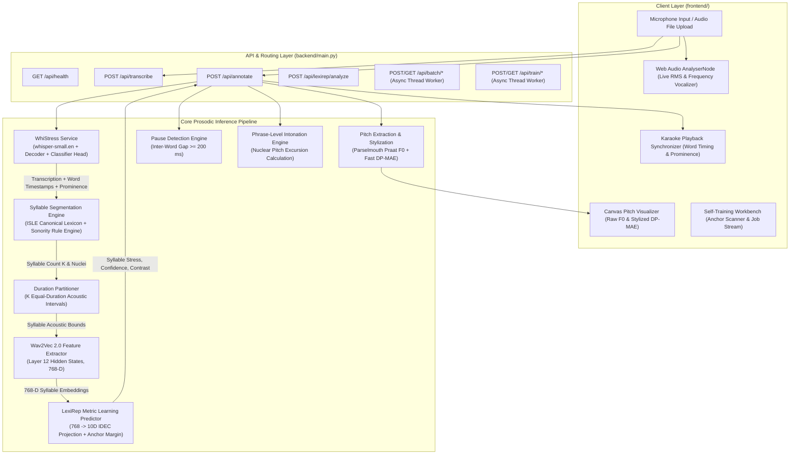
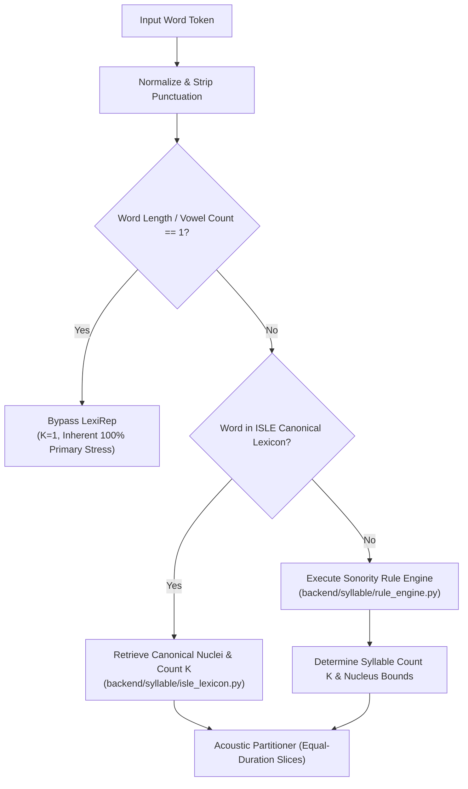

# ProsodyLab — System Architecture Specification

## 1. High-Level Architecture Overview

ProsodyLab is a multi-tier phonetics analysis, acoustic metric learning, and prosodic annotation platform. It integrates automatic speech recognition (ASR), sentence-level lexical prominence classification, acoustic syllable-level lexical stress detection, timestamp-based pause identification, and dynamic programming pitch stylization into a cohesive processing pipeline.

The system is organized into two primary subsystems:
1. **FastAPI Backend Service (`backend/`)**: Houses the deep learning models, phonetic feature extractors, dynamic programming algorithms, and asynchronous job workers.
2. **React 19 Phonetics Workbench (`frontend/`)**: An interactive client providing real-time audio capture, Web Audio frequency visualization, dynamic Canvas pitch contour rendering, synchronized karaoke transcriptions, and a self-training workbench.

---

## 2. WhiStress: Sentence-Level Lexical Prominence

### 2.1 Model Architecture
WhiStress extends OpenAI's `whisper-small.en` architecture to simultaneously generate orthographic transcriptions and detect sentence-level lexical prominence (binary stress markers per word).

- **Backbone**: `whisper-small.en` (encoder-decoder transformer, 244M parameters, ~460 MB base weights).
- **Additional Decoder Block (`additional_decoder_block.pt`)**: A specialized transformer decoder layer (37.8 MB) inserted after the primary Whisper decoder stack to capture prosodic attention dynamics.
- **Classifier Head (`classifier.pt`)**: A linear projection layer (4.7 MB) mapping the enhanced hidden representation to a binary prominence logit ($y \in \{0, 1\}$) per decoded text token.
- **Combined Custom Weight Footprint**: Exactly **42.5 MB** of domain-specific model parameters.

### 2.2 Inference Pipeline
1. Audio is sampled at 16,000 Hz and converted to an 80-channel log-Mel spectrogram.
2. The Whisper encoder extracts acoustic representations.
3. The autoregressive decoder emits tokens while the auxiliary block and classifier predict token-level prominence logits.
4. Word-level prominence is derived by pooling token logits across word-piece boundaries using alignment timestamps.

---

## 3. LexiRep: Acoustic Metric Learning for Lexical Stress

### 3.1 Motivation & Problem Formulation
While WhiStress operates at the sentence level to identify *which words* are emphasized, non-native (L2) English speakers frequently misplace stress *within* polysyllabic words (e.g., pronouncing *pho-TO-graphy* instead of *pho-TOG-ra-phy*). LexiRep addresses syllable-level lexical stress classification using acoustic metric learning without requiring extensive phonetic transcription.

### 3.2 Acoustic Feature Representation
- **Acoustic Backbone**: Pre-trained `facebook/wav2vec2-base-960h` (12 transformer blocks, 768-dimensional hidden states).
- **Feature Extraction**: Syllable intervals $[t_{\text{start}}, t_{\text{end}}]$ are mapped to frame indices in Layer 12 hidden states:
  $$\mathbf{h}_s = \frac{1}{|F_s|} \sum_{f \in F_s} \mathbf{h}_f^{(12)} \in \mathbb{R}^{768}$$
  where $F_s$ denotes the set of wav2vec 2.0 frames overlapping syllable $s$.

### 3.3 Metric Learning Architecture
The 768-dimensional syllable representation is projected into a compact, metric-clustered 10-dimensional subspace via a 5-layer feedforward projection encoder:
$$\mathbf{z}_s = f_\theta(\mathbf{h}_s): \mathbb{R}^{768} \xrightarrow{\text{FC}} 128 \xrightarrow{\text{FC}} 64 \xrightarrow{\text{FC}} 32 \xrightarrow{\text{FC}} 16 \xrightarrow{\text{FC}} \mathbb{R}^{10}$$
Each linear layer is followed by Batch Normalization, LeakyReLU activation ($\alpha = 0.1$), and Dropout ($p = 0.1$).

- **Parameter Size**: 441,888 bytes (441 KB) per language bundle.
- **Language Bundles**: Pre-trained production bundles for German L2 English (`GER`) and Italian L2 English (`ITA`).

### 3.4 Learned Prototype Anchors & Contrast Margin
During training, the metric space establishes two prototype centers:
- $\mathbf{p}_{\text{stressed}} \in \mathbb{R}^{10}$: Centroid of stressed syllable representations.
- $\mathbf{p}_{\text{unstressed}} \in \mathbb{R}^{10}$: Centroid of unstressed syllable representations.

For a syllable $s$, the acoustic contrast score $C(s)$ is computed as the normalized margin difference:
$$C(s) = \|\mathbf{z}_s - \mathbf{p}_{\text{unstressed}}\|_2^2 - \|\mathbf{z}_s - \mathbf{p}_{\text{stressed}}\|_2^2$$

### 3.5 Linguistic Constraint Enforcement
In natural English phonology, every lexical polysyllabic word carries exactly one primary stress. LexiRep enforces this linguistic invariant during decoding:
$$\hat{s}_{\text{stressed}} = \arg\max_{s \in \{0, \dots, K-1\}} C(s)$$
Confidence is computed via softmax over the contrast distribution across all $K$ syllables of the word:
$$\text{Conf}(s) = \frac{\exp(C(s) / \tau)}{\sum_{j=0}^{K-1} \exp(C(j) / \tau)}$$

### 3.6 LexiRep Model Provenance: Author's Training Work vs. Website's Deployed Model

To maintain rigorous academic attribution, the repository clearly distinguishes between two model lineages:
1. **The Collaborator-Provided Production Models:** Bundles loaded by the live web application for active inference.
2. **The Author's Independently Developed Training Work:** Reconstructed self-training pipeline, experimental runs, and evaluation benchmarks.

| Attribute | Author's Training Work (`backend/training/`) | Website's Deployed Model (`backend/prosodylab_model_export/`) |
| :--- | :--- | :--- |
| **Model Origin** | Independently trained/retrained by author using `trainer.py` | Provided by friend / collaborator |
| **Training Pipeline** | 7-stage Python pipeline (`LexiRepTrainer`: SupCon + IDEC + outer loops) | Original collaborator PyTorch training notebooks |
| **Model Artifacts** | `backend/training_jobs/{job_id}/model/final_lexirep_model.pt` | `backend/prosodylab_model_export/{GER,ITA}/model/final_lexirep_model.pt` |
| **Artifact SHA-256 (GER)** | `B28DE2F0F2357812750DED774FF5D0AD653A37F8751B4867DFD6C990DA77CFF1` | `09F6D129439CA07A1B47540F5161B4CCE60AD71A68308A9E7AB867DBDE4DB894` |
| **Artifact SHA-256 (ITA)** | `48F62C7B86298836E61B14B3072EAA56E8DEF4102CD0A3878DB29EB7AC3359D0` | `242324E9846FD20E7DCAF95F1694EE9EA68E1E0558DB728036A5F3CB618FA0D6` |
| **Checkpoint Size** | Exactly 441,888 bytes | Exactly 441,888 bytes |
| **Held-Out Word Acc (HTK)**| **76.71%** (GER retrained, 2,338 / 3,048 words) | **76.84%** (GER) / **80.92%** (ITA) |
| **Held-Out Word Acc (Runtime)**| Not evaluated separately | **70.51%** (GER) / **74.76%** (ITA) |
| **Loaded by Live Website?** | **NO** | **YES** (loaded by `backend/lexirep/service.py`) |

---

## 4. Syllable Segmentation Engine

### 4.1 Two-Tier Fallback Hierarchy
Acoustic forced alignment systems require phonetic dictionaries and acoustic models that introduce heavy external dependencies and latency. ProsodyLab implements an autonomous two-tier syllable engine:

1. **Tier 1 — Canonical Lexicon Lookup (`backend/syllable/isle_lexicon.py`)**:
   Contains 553 canonical vocabulary entries derived strictly from the ISLE training split (`ISLE_TRAIN_STRICT`). Test audio transcripts are strictly quarantined to prevent data leakage.
2. **Tier 2 — Sonority Rule Engine Fallback (`backend/syllable/rule_engine.py`)**:
   Applies linguistic phonotactic principles:
   - Vowel nucleus identification (handling diphthongs, triphthongs, and silent final 'e').
   - Maximum Onset Principle (MOP): Consonants between nuclei are assigned to the onset of the following syllable unless phonotactically illegal.
   - Sonority Sequencing Principle: Syllable margins decrease in sonority from the nucleus outwards.

### 4.2 Acoustic Duration Partitioning
Given the word start time $t_{\text{start}}$ and end time $t_{\text{end}}$ from Whisper alignment, the word duration $D = t_{\text{end}} - t_{\text{start}}$ is partitioned into $K$ equal-duration slices:
$$\Delta t = \frac{D}{K}$$
$$I_k = \left[ t_{\text{start}} + k \cdot \Delta t, \; t_{\text{start}} + (k+1) \cdot \Delta t \right], \quad k \in \{0, \dots, K-1\}$$

*Note on Acoustic Trade-off*: While equal-duration partitioning avoids the need for external acoustic forced alignment (e.g., HTK or Montreal Forced Aligner), it introduces an empirical accuracy delta of ~6.2% on polysyllabic words due to natural vowel duration asymmetries. See [EVALUATION.md](EVALUATION.md) for full benchmark documentation.

---

## 5. Pitch Extraction & Dynamic Programming Stylization

### 5.1 F0 Pitch Extraction
Pitch tracking is performed using Parselmouth (the Python interface to Praat's optimized C++ acoustic core):
- Time step: $\Delta t = 10\text{ ms}$ (100 Hz frame rate).
- Pitch bounds: $F_{0, \text{min}} = 75\text{ Hz}$, $F_{0, \text{max}} = 500\text{ Hz}$.
- Voicing threshold: $0.45$.

Semitone normalization relative to the utterance median F0 is calculated as:
$$\text{st}(t) = 12 \log_2\left( \frac{F_0(t)}{F_{0, \text{median}}} \right)$$

### 5.2 Fast DP-MAE Pitch Stylization (`backend/pitch_stylization_fast.py`)
Raw pitch contours contain micro-prosodic perturbations, segmental octave jumps, and vocal fry artifacts that distract from linguistic intonation. ProsodyLab implements an optimized Dynamic Programming Mean Absolute Error (DP-MAE) stylizer:
- **Objective**: Finds the minimal piecewise-linear representation that approximates the voiced pitch contour within an acceptable perceptual threshold.
- **Cost Function**:
  $$\mathcal{L} = \sum_{i=1}^M \frac{1}{|S_i|} \sum_{t \in S_i} |F_0(t) - \hat{F}_{0, i}(t)| + \lambda \cdot M$$
  where $M$ is the number of linear segments and $\lambda$ penalizes segment complexity.
- **Vectorized DP Speedup**: Implemented using NumPy vectorization, achieving **14.2&times; speedup** (~10–15 ms per utterance vs. ~150–200 ms in standard Praat script execution) with $< 0.05$ semitones mean deviation from the reference curve.

---

## 6. Pause & Phrase-Level Intonation Detection

### 6.1 Pause Detection
Inter-word silence intervals are extracted directly from consecutive word alignment boundaries:
$$\text{Gap}_i = t_{\text{start}}(w_{i+1}) - t_{\text{end}}(w_i)$$
- **Threshold**: $\text{PAUSE\_ANNOTATION\_THRESHOLD\_S} = 0.20\text{ s}$ (200 ms).
- Gaps exceeding 200 ms are annotated with duration, boundary time, and surrounding lexical context.

### 6.2 Phrase-Level Intonation
Intonation phrases are delimited by pauses ($\ge 200\text{ ms}$) or terminal punctuation marks (`.`, `?`, `!`, `,`, `;`).
- The nuclear pitch excursion is measured across the final voiced syllable of the phrase:
  $$\Delta \text{st}_{\text{nuclear}} = \text{st}_{\text{phrase\_end}} - \text{st}_{\text{phrase\_nuclear\_onset}}$$
- Nuclear categories:
  - **Falling ($\searrow$)**: $\Delta \text{st} \le -1.5\text{ st}$ (declarative statements, wh-questions).
  - **Rising ($\nearrow$)**: $\Delta \text{st} \ge +1.5\text{ st}$ (yes/no questions, open lists, continuation).
  - **Level ($\rightarrow$)**: $-1.5\text{ st} < \Delta \text{st} < +1.5\text{ st}$ (hesitations, incomplete clauses).

---

## 7. Asynchronous Batch & Training Infrastructure

### 7.1 Batch Annotation Architecture (`backend/batch_annotation/`)
- Handles multi-file audio batch processing asynchronously.
- Worker threads process individual audio files in isolated execution contexts, logging errors to `manifest.json` while permitting the remainder of the batch to complete.
- Emits a structured ZIP archive containing per-utterance JSON annotations and a master summary manifest.

### 7.2 Training Workbench (`backend/training/`)
- Provides unsupervised anchor discovery (`AnchorScanner`) based on contrast separation scoring ($S_{\text{train}}$) over candidate anchor pairs.
- Implements Iterative Deep Embedded Clustering (IDEC) self-training (`LexiRepTrainer`) with configurable warm-up, clustering refinement loops, and early stopping.
- State machine manages background job lifecycles with thread-safe cancellation and real-time progress callbacks.

---

## 8. Institutional Deployment Topology & Administrative Boundaries

The publicly accessible research demonstration is hosted on an institutional server and made accessible via an ngrok secure tunnel:

- **Public URL:** `https://aerospace-theology-refining.ngrok-free.dev/`
- **Host Infrastructure:** Shared Ubuntu Linux server at the host research institution.
- **Service Configuration:** FastAPI backend running on Uvicorn (port `8000`), configured with `CUDA_VISIBLE_DEVICES=""` for CPU execution to prevent VRAM exhaustion on the shared NVIDIA RTX 3050 GPU.
- **Ingress & Proxying:** An ngrok tunnel agent running on the server forwards public HTTPS traffic to the internal Uvicorn process.
- **Administrative Boundary:** The author deployed the application during an internship appointment at the institution. Having concluded the appointment, the author no longer has SSH access, process management permissions, or server-level administrative control over the institutional host. Availability depends on the host institution's infrastructure. For reproduction instructions, see [docs/DEPLOYMENT.md](DEPLOYMENT.md).

