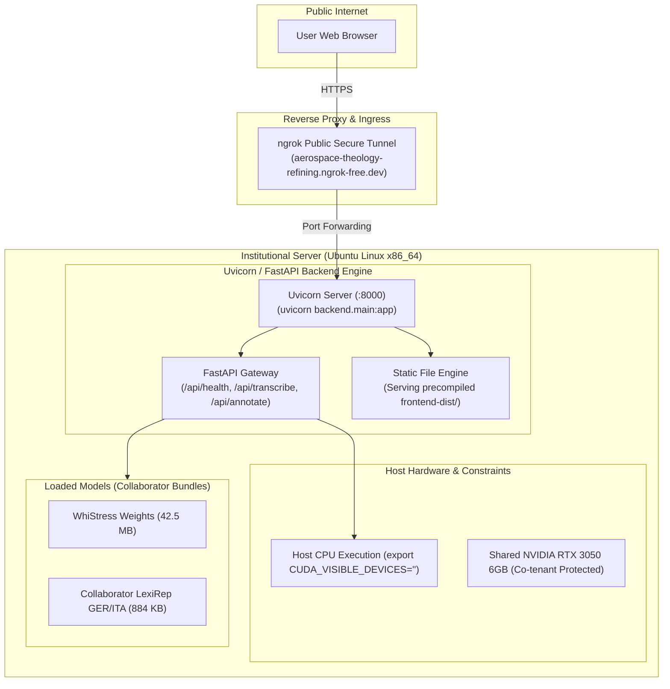

# ProsodyLab — Institutional Deployment & Reproduction Guide

This document specifies the deployment architecture of ProsodyLab, distinguishes historical institutional hosting from local development, and provides instructions for reproducing the environment on a new server.

---

## 1. Current Live Demonstration Status & Institutional Hosting

ProsodyLab was deployed on institutional server infrastructure during research and internship work at the host institution.

- **Publicly Accessible URL:** [https://aerospace-theology-refining.ngrok-free.dev/](https://aerospace-theology-refining.ngrok-free.dev/)
- **Hosting Infrastructure:** Institutional server running an Ubuntu Linux environment.
- **Exposure Mechanism:** Secure public tunnel via ngrok forwarding to the internal server application port.
- **Administrative Status:** **The author has completed their research appointment and no longer holds administrative or SSH access to the institutional server.**

> [!IMPORTANT]
> **Administrative & Infrastructure Boundary Disclaimer:**
> - The live demonstration at the ngrok URL remains operational, but is hosted entirely on institutional hardware outside the author's current control.
> - The author cannot SSH into the server, view running process trees, inspect server-side application logs, restart backend/frontend services, or redeploy updates.
> - Availability depends strictly on the institutional server remaining powered on and the ngrok tunnel process remaining active.
> - No instructions in this guide should prompt attempts to remotely access, modify, or reconfigure the institutional server.

---

## 2. Verification of Live Institutional Deployment (Read-Only Audit)

A non-destructive, read-only diagnostic check of the public URL verified the following operational attributes:

| Parameter | Observed Value | Evidence Source |
| :--- | :--- | :--- |
| **HTTP Response Status** | `200 OK` | Public HTTP request to root (`/`) and `/api/health` |
| **Server Header** | `uvicorn` | HTTP response headers returned by the server gateway |
| **Execution Device** | `"device": "cpu"` | Public health endpoint JSON: `{"status":"ok","device":"cpu","model_loaded":true}` |
| **Model Load Status** | `"model_loaded": true` | WhiStress and LexiRep services active in server memory |
| **Public Agent IP** | `14.139.82.6` (Academic Network Range) | Ngrok agent IP header (`Ngrok-Agent-Ips`) |
| **Frontend Assets** | Precompiled React 19 bundle | Served HTML references `index.html` with DM Sans & IBM Plex Mono typography |

---

## 3. Reconstructed Institutional Deployment Topology

Based on repository deployment records (`deployment/FINAL_SERVER_REQUIREMENTS.md`, `deployment/runtime-config.md`, `deployment/DEPLOYMENT_MANIFEST.md`), the institutional server was configured as follows:



### 3.1 Host Environment & Hardware Profile
- **Operating System:** Ubuntu 22.04 / 24.04 LTS (x86_64).
- **Execution User:** Standard non-root user account (e.g. `/home/slfi2/prosodylab`).
- **GPU Resource Constraint:** The institutional server contained an NVIDIA RTX 3050 (6 GB VRAM) shared with another researcher who actively utilized ~2.8 GB VRAM. To avoid CUDA Out-of-Memory (`torch.cuda.OutOfMemoryError`) conflicts during concurrent worker execution, the server was configured with:
  ```bash
  export CUDA_VISIBLE_DEVICES=""
  ```
  forcing CPU-only execution for stability. This directly accounts for the `"device": "cpu"` output confirmed in the public health check.

### 3.2 Backend Service Configuration
- **Application Framework:** FastAPI running on Uvicorn.
- **Port Binding:** Listening locally on port `8000` (`--host 127.0.0.1 --port 8000 --workers 1`).
- **Environment Variables:**
  - `PYTHONPATH="$PWD:$PWD/backend"`
  - `CUDA_VISIBLE_DEVICES=""`
  - `HF_HOME="$HOME/.cache/huggingface"`

### 3.3 Frontend Asset Serving & API Routing
- The frontend was pre-compiled into static distribution assets located in `frontend-dist/` (`index.html`, JavaScript, CSS).
- In production, static assets are served directly through the web tier, with all client API calls utilizing root-relative `/api/...` endpoints. This architecture completely eliminated cross-origin resource sharing (CORS) issues across different ports.

### 3.4 Public Ingress via ngrok
- An ngrok tunnel client was initiated on the institutional server:
  ```bash
  ngrok http 8000
  ```
- Assigned the domain: `aerospace-theology-refining.ngrok-free.dev`.
- Forwards inbound HTTPS traffic directly to the local Uvicorn process.

---

## 4. Verification Level Breakdown

| System Layer | Verification Level | Evidence / Details |
| :--- | :---: | :--- |
| **Public Website Availability** | **Confirmed Live** | Returns HTTP 200 at `https://aerospace-theology-refining.ngrok-free.dev/`. |
| **Public API Health** | **Confirmed Live** | Returns `{"status":"ok","device":"cpu","model_loaded":true}`. |
| **Model Weights Used on Site** | **Verified in Repo** | Verified collaborator GER & ITA bundles (`backend/prosodylab_model_export/`). |
| **Frontend/Backend Architecture** | **Verified in Repo** | Reconstructed from `deployment/` manifests and source code. |
| **Historical Server Configuration**| **Documented in Repo**| Detailed in `deployment/FINAL_SERVER_REQUIREMENTS.md`. |
| **Current Live Server Processes** | **Unverifiable** | **Cannot be inspected without institutional server SSH access.** |

---

## 5. Step-by-Step Instructions: Reproducing on a New Server

To replicate the complete ProsodyLab deployment on a new standalone cloud or institutional server (Ubuntu 22.04/24.04 LTS):

### Step 5.1: Install System Prerequisites
```bash
sudo apt update && sudo apt install -y \
    python3.11 \
    python3.11-venv \
    python3.11-dev \
    build-essential \
    ffmpeg \
    libsndfile1 \
    git \
    nodejs \
    npm
```

### Step 5.2: Clone Repository & Set Up Virtual Environment
```bash
git clone https://github.com/Sreelm10sj/ProsodyLab.git
cd ProsodyLab

python3.11 -m venv backend/venv
source backend/venv/bin/activate
pip install --upgrade pip setuptools wheel
pip install -r backend/requirements.txt
```

### Step 5.3: Acquire Model Weights
```bash
# Download WhiStress prominence classifier weights (42.5 MB)
python backend/WhiStress/download_weights.py

# Collaborator LexiRep production models (GER & ITA) are already
# verified and present in backend/prosodylab_model_export/
```

### Step 5.4: Compile Frontend Distribution
```bash
cd frontend
npm install
npm run build
cd ..
```
The compiled production bundle is generated in `frontend/dist/`.

### Step 5.5: Launch Backend Engine
```bash
source backend/venv/bin/activate

# Choose execution device (CPU for stability or CUDA if dedicated GPU is available):
export CUDA_VISIBLE_DEVICES=""   # CPU-only (recommended for shared servers)
# export CUDA_VISIBLE_DEVICES="0" # GPU acceleration (if >= 6 GB free VRAM)

export PYTHONPATH="$PWD:$PWD/backend"
uvicorn backend.main:app --host 127.0.0.1 --port 8000 --workers 1
```

### Step 5.6: Configure Reverse Proxy (Nginx) & Public Tunnel
Configure Nginx to serve `frontend/dist` and proxy `/api/`:
```nginx
server {
    listen 80;
    server_name my-prosodylab.example.edu;
    client_max_body_size 250M;

    location / {
        root /path/to/ProsodyLab/frontend/dist;
        index index.html;
        try_files $uri $uri/ /index.html;
    }

    location /api/ {
        proxy_pass http://127.0.0.1:8000/api/;
        proxy_http_version 1.1;
        proxy_set_header Upgrade $http_upgrade;
        proxy_set_header Connection "upgrade";
        proxy_set_header Host $host;
        proxy_read_timeout 600s;
    }
}
```

Alternatively, expose port 8000 directly via ngrok:
```bash
ngrok http 8000
```

