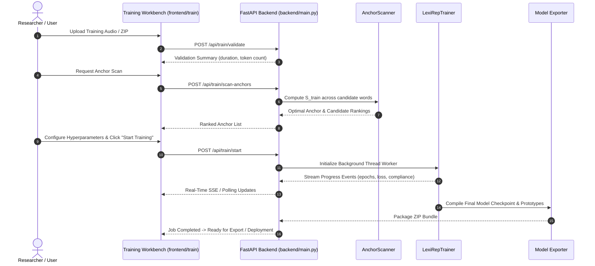

# ProsodyLab — Self-Training Workbench & Acoustic Metric Learning Guide

This guide documents the procedures for dataset preparation, unsupervised anchor discovery, metric-learning model self-training, and model bundle export using the ProsodyLab Training Workbench (`backend/training/`).

---

## 1. Overview & Theoretical Principles

LexiRep uses an Iterative Deep Embedded Clustering (IDEC) metric-learning strategy to project 768-dimensional Wav2Vec 2.0 syllable embeddings into a 10-dimensional space where primary-stressed and unstressed syllables form separable geometric clusters.

Training is semi-supervised or self-supervised through **acoustic anchor words**:
- An **anchor word** is a high-confidence polysyllabic lexical token where acoustic separation between syllables is prominent (e.g. *foot-ball*, *to-day*).
- Candidate anchors are discovered automatically by scanning unlabelled or weakly-labelled speech for pairs exhibiting maximal margin separation.
- The projection encoder is optimized via contrastive cluster loss combined with autoencoder reconstruction to preserve acoustic structure while expanding the inter-cluster margin.

---

## 2. Dataset Preparation & Format

### 2.1 Audio Specifications
- **Format:** Uncompressed 16-bit PCM WAV (or standard MP3/FLAC).
- **Sampling Rate:** 16,000 Hz mono (automatically resampled during feature extraction).
- **Duration:** Individual utterance files between 1.0 and 15.0 seconds.

### 2.2 Directory Layout
Organize training corpora into a zip archive or directory:
```
my_training_corpus/
├── audio/
│   ├── speaker01_001.wav
│   ├── speaker01_002.wav
│   └── ...
└── transcripts.csv (optional)
```

`transcripts.csv` format (if provided):
```csv
filename,transcription
speaker01_001.wav,"The football match was delayed."
speaker01_002.wav,"University degrees are valued."
```

If transcripts are omitted, WhiStress automatically transcribes the audio during dataset ingestion.

---

## 3. Step-by-Step Training Workflow



### Step 1: Validate Training Dataset
Submit the dataset to `POST /api/train/validate`. The backend inspects:
- Audio readability and sample rates.
- Whisper transcription confidence.
- Vocabulary syllable distribution (ensuring sufficient bisyllabic and trisyllabic tokens).

### Step 2: Unsupervised Anchor Discovery
Execute `POST /api/train/scan-anchors`. The scanner calculates the acoustic separation score $S_{\text{train}}$ for each candidate word $w$:
$$S_{\text{train}}(w) = \frac{\|\mathbf{h}_{\text{syl\_1}} - \mathbf{h}_{\text{syl\_2}}\|_2}{\sum_{i} \sigma_i}$$
Top-ranked words exhibiting stable separation across speaker repetitions are designated as defensible anchors.

### Step 3: Configure Hyperparameters
The workbench provides verified protocol defaults tailored to specific L2 learner populations:

| Hyperparameter | German (`GER`) Default | Italian (`ITA`) Default | Description |
| :--- | :---: | :---: | :--- |
| `top_k_rep` | **1** | **10** | Syllable prototype margin depth. |
| `batch_words` | **32** | **48** | Polysyllabic words sampled per gradient step. |
| `warmup_epochs` | **15** | **15** | Initial projection layer warm-up. |
| `idec_pretrain_epochs`| **10** | **10** | Unsupervised cluster pre-training epochs. |
| `outer_loops` | **5** | **5** | Iterative cluster assignment re-estimation cycles. |
| `idec_steps_per_loop` | **20** | **25** | Gradient steps per clustering loop. |
| `learning_rate` | **$10^{-3}$** | **$10^{-3}$** | Adam optimizer initial learning rate. |

### Step 4: Execute & Monitor Training
Initiate training via `POST /api/train/start`. 
- Monitor live progress in the workbench UI (loss curves, learning rate decay, and linguistic compliance).
- **Linguistic Compliance Metric**: Monitors whether the model satisfies the phonological invariant that every polysyllabic word receives exactly one primary stress. Compliance should reach **100%** within early epochs.

### Step 5: Export & Deploy Model Bundle
Once training concludes, download the generated model bundle via `POST /api/train/export/{job_id}`.

#### Bundle Structure:
```
exported_bundle.zip
├── config.json               # Hyperparameters, random seed, training timestamp
├── anchors.json              # Selected anchor words, syllable indices, S_train
├── metrics.json              # Final loss, compliance rate, verification status
├── training_history.csv      # Epoch-by-epoch loss and compliance log
├── model/
│   └── final_lexirep_model.pt   # PyTorch state dict (441 KB)
└── anchors/
    └── prototypes_10d.npy       # 2 x 10 float32 prototype centroids
```

#### Hot-Deploying the Trained Bundle:
To make the new model bundle the active production engine for inference:
1. Extract the bundle into `backend/prosodylab_model_export/{LANG}/` (replacing existing contents).
2. Restart the FastAPI backend or call the reload endpoint.
3. Verify loaded status via `GET /api/health`.

---

## 4. Academic Integrity: Training Metrics vs. Held-Out Generalization

> [!WARNING]
> **Essential Academic Caution:**
> A training run that achieves **100% linguistic compliance** and low clustering loss on the training set **does NOT imply** that accuracy on new speakers will be 100%.
>
> In our empirical server-side validation on Linux:
> - The model converged with 100% compliance.
> - Evaluation on 3,048 held-out test words achieved **76.71% exact word accuracy** (matching the production baseline of 76.84%).
>
> When presenting research findings, always report performance on a **strictly partitioned held-out speaker test set**, never on training convergence metrics.

